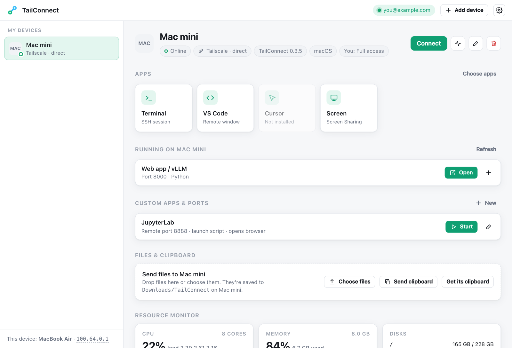
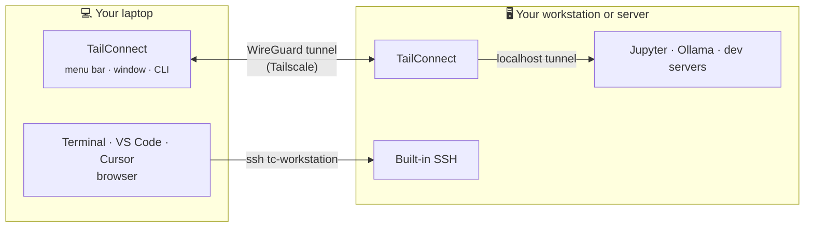

<div align="center">


# TailConnect

**Every computer you own, one click away.**

Open a terminal, VS Code or Cursor on any of your machines, reach their web apps on `localhost`,<br>
and watch their CPU, GPU and memory — over a private, encrypted network that sets itself up.

[](https://github.com/imbikramsaha/TailConnect/actions/workflows/ci.yml)
[](https://github.com/imbikramsaha/TailConnect/actions/workflows/codeql.yml)
[](https://github.com/imbikramsaha/TailConnect/releases/latest)
[](LICENSE)


[**Download**](#download) · [Features](#features) · [How it works](#how-it-works) · [Security](#security) · [FAQ](#faq)

<br>

<picture>
  <source media="(prefers-color-scheme: dark)" srcset="docs/assets/screenshot-dark.png">
  
</picture>

</div>

---

## Download

<table>
<tr>
<th align="center" width="33%">macOS</th>
<th align="center" width="33%">Windows</th>
<th align="center" width="33%">Linux</th>
</tr>
<tr>
<td align="center"><a href="https://github.com/imbikramsaha/TailConnect/releases/latest/download/TailConnect-macos.dmg"><b>Download for Mac</b></a><br><sub>macOS 13+ · Apple Silicon &amp; Intel</sub></td>
<td align="center"><a href="https://github.com/imbikramsaha/TailConnect/releases/latest/download/TailConnect-windows-setup.exe"><b>Download for Windows</b></a><br><sub>Windows 10 &amp; 11 · no admin rights needed</sub></td>
<td align="center"><a href="https://github.com/imbikramsaha/TailConnect/releases/latest/download/tailconnect_linux_amd64.deb">.deb</a> · <a href="https://github.com/imbikramsaha/TailConnect/releases/latest/download/tailconnect_linux_x86_64.rpm">.rpm</a> <sub>(x64)</sub><br><a href="https://github.com/imbikramsaha/TailConnect/releases/latest/download/tailconnect_linux_arm64.deb">.deb</a> · <a href="https://github.com/imbikramsaha/TailConnect/releases/latest/download/tailconnect_linux_aarch64.rpm">.rpm</a> <sub>(ARM64)</sub></td>
</tr>
</table>

Or install with one command — it picks the right download, verifies it and starts TailConnect:

**macOS and Linux**

```sh
curl -fsSL https://github.com/imbikramsaha/TailConnect/releases/latest/download/install.sh | sh
```

**Windows** (PowerShell)

```powershell
irm https://github.com/imbikramsaha/TailConnect/releases/latest/download/install.ps1 | iex
```

<details>
<summary><b>More install options</b></summary>
<br>

| Method | Command or link |
|---|---|
| Homebrew (macOS) | `brew tap imbikramsaha/tap && brew trust imbikramsaha/tap && brew install --cask tailconnect` |
| Windows portable | [TailConnect-windows-amd64.zip](https://github.com/imbikramsaha/TailConnect/releases/latest/download/TailConnect-windows-amd64.zip) |
| Linux, any distribution (no root) | [x64 .tar.gz](https://github.com/imbikramsaha/TailConnect/releases/latest/download/tailconnect_linux_amd64.tar.gz) · [ARM64 .tar.gz](https://github.com/imbikramsaha/TailConnect/releases/latest/download/tailconnect_linux_arm64.tar.gz) — the install command falls back to this automatically |
| A specific version | Set `TAILCONNECT_VERSION=0.3.8` before the install command, or browse [all releases](https://github.com/imbikramsaha/TailConnect/releases) |
| Servers (headless) | `tailconnect --headless` prints a sign-in link; `--authkey-file <file>` signs in unattended |

The install commands check every download against the release's SHA-256 checksums, and against TailConnect's release signature wherever OpenSSL 3 is available. Every release file also carries a signed build attestation: `gh attestation verify <file> --repo imbikramsaha/TailConnect`.

**Preview builds aren't code-signed yet.** If you download the app in a browser, macOS asks you to right-click → **Open** the first time, and Windows SmartScreen may show **More info → Run anyway**. The install commands avoid both prompts.

</details>

## Quick start

1. **Install TailConnect** on two or more computers.
2. **Sign in** on each with the same account — Google, Microsoft, GitHub or Apple, through [Tailscale](https://tailscale.com) (free for personal use).
3. **That's it.** Your computers find each other and pair automatically. Click a device, then **Terminal** or **VS Code**.

To connect with someone else's computer, they click **Pair** on yours and you approve — both screens show the same 6-digit code.

## Features

### Connect from anywhere
- **Zero configuration** — no VPN, port forwarding or SSH keys to set up. Works across home, office, mobile and cloud networks, peer-to-peer whenever possible.
- **No extra apps** — TailConnect runs its own Tailscale connection, or shares the Tailscale app's if you already use it.
- **Automatic pairing** for your own devices; approval with a confirmation code for everyone else.
- **Any SSH host** — add Linux and macOS machines that don't run TailConnect.

### Work on any machine
- **One-click Terminal, VS Code, Cursor, Windsurf and Zed** — TailConnect serves SSH itself, so there's nothing to enable on the other computer.
- **Running services** — Jupyter, Ollama, ComfyUI or your dev server are detected automatically; one click opens them in your browser.
- **Custom apps** with launch scripts and ready-made templates for JupyterLab, Ollama, Open WebUI, ComfyUI, Stable Diffusion, code-server, TensorBoard, Streamlit and vLLM.
- **Screen sharing** through your private network with [RustDesk](https://rustdesk.com) (works between every system, Windows Home included) or the built-in Screen Sharing / Remote Desktop — no RustDesk servers or open ports needed.
- **File transfer**, **clipboard sharing** and **Wake-on-LAN** for sleeping machines.
- **Works with your tools** — every device gets an alias, so `ssh tc-desktop`, `scp`, `rsync` and JetBrains Gateway just work.

### Know what's happening
- **Live resource monitor** — CPU per core, memory, NVIDIA GPU (usage, VRAM, temperature, power), disks and network.
- **Processes and Docker** — see what's running, stop processes, start and stop containers.
- **Alerts** for GPU temperature, full disks and memory pressure; **connection test** for latency, speed and route.
- **Activity log** of sessions, pairings and changes on each computer.

### Secure by design
- **Access levels per device** — full access, ports only, or monitor only — enforced on every request.
- **Two-factor device identity** — Tailscale identity *and* a signed request from the paired key.
- **Signed updates** — the app only installs releases signed with the maintainer's offline key.
- **Open source** under Apache 2.0, with CodeQL, fuzzing and dependency scanning in CI.

## How it works



Each TailConnect joins your private [tailnet](https://tailscale.com/kb/1136/tailnet) and finds the other TailConnect devices on it. Paired devices talk directly over encrypted WireGuard tunnels — through relays only when a direct path isn't possible. TailConnect has no servers of its own, and your traffic never passes through ours.

## Security

TailConnect gives paired devices real access to each other, so security is built in from the ground up:

| | |
|---|---|
| **Identity** | Every request is authenticated twice: Tailscale identifies the machine, and the request must be signed with the key that device paired with. Other programs or users on a paired machine get nothing. |
| **Access control** | Grant each device *Full access*, *Ports & monitor* or *Monitor only*, optionally limited to specific ports. Revoking closes open sessions and tunnels immediately. |
| **Untrusted input** | Everything another device reports is validated before it reaches your SSH config, commands, notifications or the UI. |
| **Local app** | The control interface listens only on `127.0.0.1`, uses per-window sessions (never cookies) and refuses requests from websites. |
| **Supply chain** | Signed releases, build provenance, SHA-pinned CI, CodeQL, fuzz tests and Dependabot. |

Read the full [security model](SECURITY.md). To report a vulnerability, use [private vulnerability reporting](https://github.com/imbikramsaha/TailConnect/security/advisories/new) — please don't open a public issue.

## Platform support

| | macOS | Windows | Linux |
|---|---|---|---|
| **Versions** | 13 Ventura and later | 10 (1809+) and 11 | Ubuntu 22.04+, Debian 12+, Fedora, and others via `.tar.gz` |
| **Architectures** | Apple Silicon, Intel | x64 | x64, ARM64 |
| **Built-in SSH** | ✓ | ✓ | ✓ |
| **App window** | Native (WebKit) | Native (WebView2) | Native (WebKitGTK), or browser |
| **Tray** | Menu bar | System tray | System tray (GNOME needs the AppIndicator extension) |

## Command line

TailConnect includes a command-line tool (installed by the install commands, Homebrew and the Windows installer):

```text
tailconnect status                    Sign-in state and devices
tailconnect devices                   List devices
tailconnect connect <device>          Connect to a device (name, alias or id)
tailconnect ssh <device> [args]       Open an SSH session
tailconnect pair list                 Pending pairing requests
tailconnect pair approve <id> <full|ports|stats>
tailconnect pair deny <id>            Decline a pairing request
tailconnect open                      Open the TailConnect window
tailconnect quit                      Quit the app
tailconnect cleanup                   Remove TailConnect's SSH keys and config (before uninstalling)
```

## FAQ

<details>
<summary><b>Do I need a Tailscale account or the Tailscale app?</b></summary>
<br>
You need a free Tailscale account to sign in — you can use Google, Microsoft, GitHub or Apple. You don't need the Tailscale app; if you already have it, TailConnect can share its connection. You can also use a self-hosted <a href="https://headscale.net">Headscale</a> server.
</details>

<details>
<summary><b>What can a paired device do on my computer?</b></summary>
<br>
Exactly what you allow. <i>Full access</i> is the same as a terminal as your user; <i>Ports &amp; monitor</i> reaches services on your computer's localhost and the resource monitor; <i>Monitor only</i> sees resource usage. Devices on your own Tailscale account get the access level set in <b>Settings → Access for my devices</b>. Review and revoke access in <b>Settings → Devices &amp; access</b>.
</details>

<details>
<summary><b>Does my data go through someone else's servers?</b></summary>
<br>
No. Connections are end-to-end encrypted WireGuard tunnels between your devices. Tailscale's coordination service sees which devices are in your tailnet (names and addresses), not your traffic. TailConnect itself has no servers; the only other connection it makes is to GitHub to check for updates.
</details>

<details>
<summary><b>How is this different from SSH, VS Code Remote or Tailscale alone?</b></summary>
<br>
Tailscale gives your devices a private network. TailConnect builds on it: devices find and pair with each other, terminals and editors open in one click with nothing to configure on the other machine, services are detected and forwarded for you, and you get resource monitoring, file and clipboard sharing, screen sharing and Wake-on-LAN in one place.
</details>

<details>
<summary><b>How do I set up screen sharing?</b></summary>
<br>

Click **Screen** on a device. TailConnect connects through your private network and opens the best viewer available:

1. **RustDesk** (recommended — any system to any system): install [RustDesk](https://rustdesk.com) on both computers and, on the one you want to see, turn on **Settings → Security → Enable direct IP access** and set a permanent password. TailConnect connects RustDesk directly through the tunnel; no RustDesk servers are involved.
2. **Built-in tools**: macOS **Screen Sharing** (System Settings → General → Sharing), or **Remote Desktop** on Windows Pro/Enterprise and Linux. To view a Windows PC from a Mac, install Microsoft's free **Windows App**.

If something is missing, TailConnect tells you exactly what to turn on or install.
</details>

<details>
<summary><b>Where does TailConnect store its data, and how do I uninstall it?</b></summary>
<br>

| | macOS | Windows | Linux |
|---|---|---|---|
| Settings, logs | `~/Library/Application Support/TailConnect` | `%AppData%\TailConnect` | `~/.config/TailConnect` |
| SSH key and device aliases | `~/.ssh/tailconnect/` | `%USERPROFILE%\.ssh\tailconnect\` | `~/.ssh/tailconnect/` |

Uninstall from <b>Settings → Apps</b> (Windows), with <code>brew uninstall --cask tailconnect</code>, or by moving the app to the Trash (macOS). On Linux, run <code>tailconnect cleanup</code>, then remove the package. The Windows uninstaller and Homebrew run the cleanup for you.
</details>

## Roadmap

- [x] **Device access** — pairing, one-click apps, services, monitoring, file and screen sharing on macOS, Windows and Linux
- [ ] **Files in your file manager** — browse other devices' folders in Finder, File Explorer and Files
- [ ] **Code-signed and notarized builds**
- [ ] **Mobile companion app**
- [ ] **Teams** — shared devices and access policies

## Contributing

Bug reports, ideas and pull requests are welcome. See [CONTRIBUTING.md](CONTRIBUTING.md) to get started and [docs/DEVELOPMENT.md](docs/DEVELOPMENT.md) for building, testing and the project layout.

## License

TailConnect is open source under the [Apache License 2.0](LICENSE).

<sub>Tailscale is a trademark of Tailscale Inc. TailConnect is an independent project and is not affiliated with or endorsed by Tailscale Inc.</sub>
